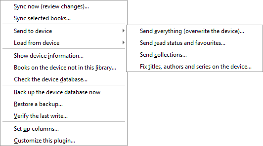

# docs

Not shipped in the plugin zip. `build.py` skips this directory.

* `wiki/` — the pages published to the
  [GitHub wiki](https://github.com/Mattie112/PocketBookUtilities/wiki).
* `screenshots/` — images used by the wiki and the main README.

## Publishing the wiki

The wiki is a separate git repository. It has to exist before it can be
cloned, so if there is no wiki yet, create any one page through the web
interface first.

    git clone https://github.com/Mattie112/PocketBookUtilities.wiki.git
    cp docs/wiki/*.md PocketBookUtilities.wiki/
    cd PocketBookUtilities.wiki
    git add -A && git commit -m "Update wiki" && git push

Page names come from the filenames: `How-syncing-works.md` becomes the page
*How syncing works* at `/wiki/How-syncing-works`, which is what the links
between pages use. `_Sidebar.md` is the navigation shown beside every page.

Keeping the source here means the wiki is reviewable in a pull request and
cannot drift away unnoticed. Edit it here, then copy it over.

## Screenshots

Drop PNGs into `screenshots/` with these names. Each is referenced from an
HTML comment in the page that wants it, so adding the file is all that is
needed to wire it up.

| File | Shot |
|---|---|
| `menu.png` | The toolbar button's drop-down menu, open, with the reader connected so nothing is greyed out. Include the submenus if you can get one expanded. |
| `review.png` | The review dialog after **Sync now**, showing a few changes in both directions. |
| `wizard.png` | The first-run setup dialog, with the column preview visible. |
| `columns.png` | The library view with the `PB *` columns showing — read ticks, a progress percentage, a collection or two. Four or five rows is plenty. |
| `settings-sync.png` | The settings dialog on the **Sync** tab. |

Crop to the window, not the whole desktop. A light theme reads better on
GitHub, which renders both light and dark, but either works.

Anything with book titles in it is a screenshot of your library, so use books
you are happy to have in a public repository.

In wiki pages, reference them with the full raw URL, because a wiki page
cannot see this repository's files:

    

In the main README a relative path works:

    
