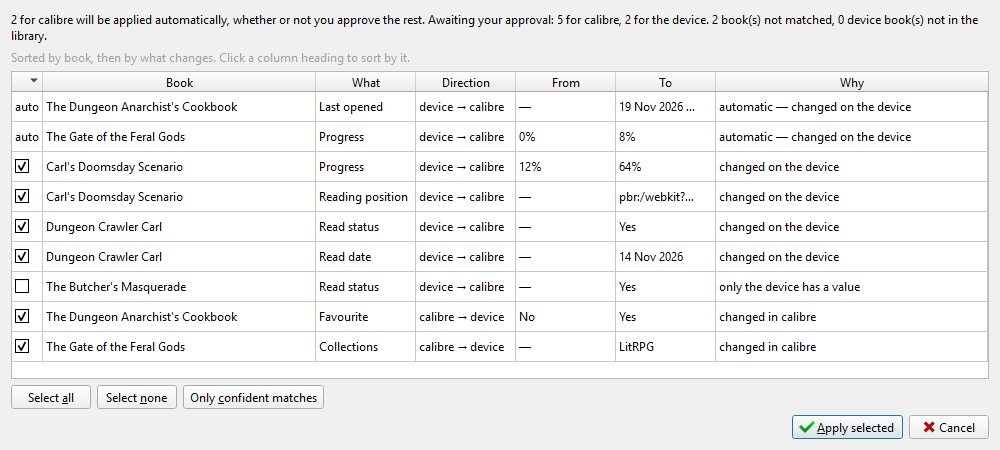

# How syncing works

Three steps every time: match the books, work out what actually changed, show
you the result.

## 1. Matching books

The plugin asks calibre which books it believes are on the device, then looks
each one up in the reader's database. Four qualities of match, best first:

| Quality | Means |
|---|---|
| **Exact path** | The file is where calibre thinks it is. Nearly everything matches here. |
| **Filename + size** | Same filename and the same byte count. |
| **Filename** | Same filename, unique on the device. |
| **Title + author** | Normalised metadata match. The weakest, and never ticked for you by default. |

*Pre-tick changes for*, on the Sync tab, sets where the line is drawn. Weaker
matches are still listed, just unticked, so you can look at them and decide.

Books the reader has that calibre did not put there are never touched. They
are listed under **Books on the device not in this library…**.

## 2. Deciding what changed

The plugin does **not** compare timestamps and hope. After every successful
sync it records what each side looked like, per book, per field. Next time it
compares each side against that record:

| Reader vs last sync | Calibre vs last sync | Result |
|---|---|---|
| unchanged | unchanged | nothing to do |
| changed | unchanged | load into calibre |
| unchanged | changed | send to the reader |
| changed | changed | conflict — the more recent one wins, flagged in the review |

This is why an idle sync proposes nothing at all, instead of writing the same
values back and forth and re-dating your library every run.

For the conflict case, *Clock tolerance* (90 seconds by default) is how far
the two clocks may differ before one side counts as genuinely newer.

Values are normalised before they are compared, so `0`, `'0'`, `None` and
`False` all mean the same thing, dates are compared to the second in UTC, and
collections are compared as a set.

### Clearing

A change that would replace a filled value with an empty one is skipped
unless *Let an empty value overwrite a filled one* is on. Without that guard,
clearing a `#pb_` column in calibre would wipe reading positions off the
device on the next sync. It applies in both directions and to forced syncs
too.

### Starting over

**Forget what was synced before…** on the Advanced tab drops the record for
this library and device. The next sync then has nothing to compare against
and treats every difference as a change. Nothing is deleted from either side.

## 3. The review dialog

One row per proposed change: the book, the field, the direction, the old
value and the new value, why the plugin wants to make it, and how confidently
the book was matched. Values are shown the way you would see them in calibre,
in both directions.

Untick anything you disagree with. Only ticked rows are written.

When the plugin has already applied something automatically — the reader →
calibre half, under the on-connect setting that allows it — those rows are
listed too, marked as applied, so the dialog is never a misleading partial
picture of what happened.

**Cancel** writes nothing further. It does not undo what was already applied
automatically.

## Writing

Changes for calibre are written one column at a time in a single batch.

Changes for the device go in one short transaction on the reader's database,
after an automatic backup. Afterwards the plugin stores a receipt of exactly
what it wrote, which **Verify the last write…** checks against the device
later. See [Backups and safety](Backups-and-safety).
