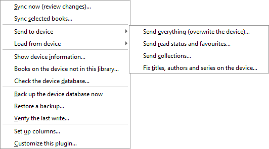

# Menu reference

Everything the plugin does is on the toolbar button's drop-down menu. Items
that cannot be used right now are greyed out with the reason in their
tooltip, rather than disappearing.

Two conditions decide most of it:

* **No PocketBook is connected** — anything that touches the device is off.
* **Run "Set up columns" first** — syncing is off until the plugin has
  somewhere to put what it reads.

## Everyday

| Item | What it does |
|---|---|
| **Sync now (review changes)…** | Compares both sides, shows you a list of proposed changes, writes only what is ticked. This is the one you will use. |
| **Sync selected books…** | The same, limited to the books selected in the library view. |

## Send to device

Forced, one-directional, and ignores what the plugin remembers from the last
sync: calibre's value wins everywhere it differs. Use these to repair a
device, not as a routine.

| Item | What it does |
|---|---|
| **Send everything (overwrite the device)…** | Every enabled field, calibre's value wins. |
| **Send read status and favourites…** | Read status and favourite. (The read date is never written to the device.) |
| **Send collections…** | Collection membership only. Greyed out if the device has no shelves table. |
| **Fix titles, authors and series on the device…** | Not a sync. See [Fixing author sorting](Fixing-author-sorting). |

## Load from device

The mirror image: the reader's value wins.

| Item | What it does |
|---|---|
| **Load everything (overwrite calibre)…** | Every enabled field. |
| **Load read status and favourites…** | Read status, read date and favourite. |
| **Load reading positions and progress…** | Position, progress and last opened. |
| **Load collections…** | Shelf membership into the collections column. |

Every forced action still shows the review dialog before writing anything.

## Looking at the device

| Item | What it does |
|---|---|
| **Show device information…** | Model, driver in use, storage id, database path, explorer and schema version, profile, and the capability list. This is what to paste into a bug report — it contains no titles and no file paths. |
| **Books on the device not in this library…** | A read-only list of books the reader has that calibre did not put there. The plugin never touches these. |
| **Check the device database…** | Runs an integrity check and reports orphaned rows. It reports; it never repairs or deletes. |

## Backups

| Item | What it does |
|---|---|
| **Back up the device database now** | An immediate copy, taken with SQLite's backup API so the write-ahead log is included. |
| **Restore a backup…** | Puts a previous copy back on the device. |
| **Verify the last write…** | Re-reads the rows the last write touched and reports any the device has since changed back. See [Backups and safety](Backups-and-safety). |

## Setup

| Item | What it does |
|---|---|
| **Set up columns…** | Creates the custom columns. Safe to run again; it reuses what it made before. |
| **Customize this plugin…** | Opens the settings dialog. Same as Preferences → Plugins → PocketBook Utilities → Customize. |
