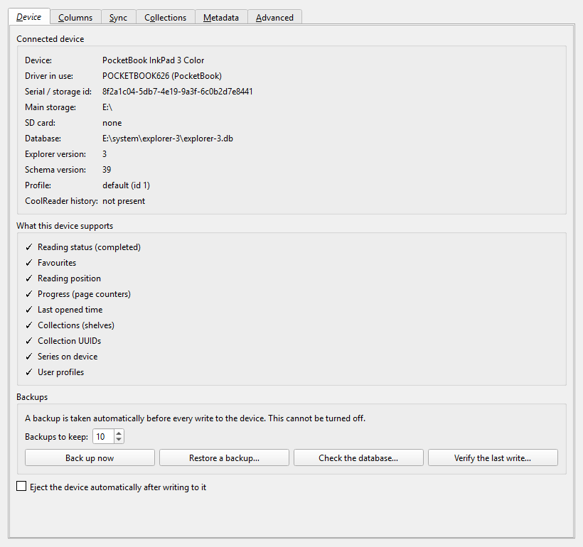
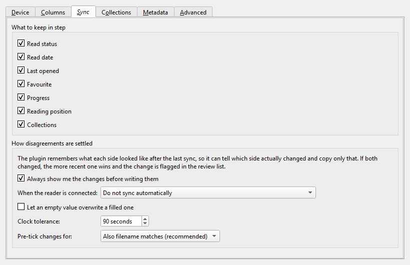

# Settings reference

**Customize this plugin…** on the menu, or **Preferences → Plugins →
PocketBook Utilities → Customize**.

Almost everything here is stored **per device, per library**. The Backups to
keep count and the debug flag are plugin-wide.

The dialog opens with no reader attached and shows the last device it saw, so
you can change settings without plugging anything in.

## Device

Read-only information first: the device name, which calibre driver is driving
it, the storage id, the database path, explorer and schema version, and the
active profile. Below that, a ticked or crossed list of what this device's
database actually supports — the plugin reads the schema rather than assuming
it, and disables features the firmware has no table for.

| Option | Default | Effect |
|---|---|---|
| Backups to keep | 10 | How many automatic backups are kept per device. The very first backup ever taken is always kept on top of this. Plugin-wide. |
| Eject the device automatically after writing to it | off | PocketBook can rewrite its database from memory when the USB connection drops, undoing what was just written. Ejecting first avoids that. |

Four buttons — **Back up now**, **Restore a backup…**, **Check the
database…** and **Verify the last write…** — do the same as their menu
entries.

## Columns

**Set up columns** creates everything in one go. Below it, one drop-down per
field under *Which column holds what*, listing every column of a compatible
type, so you can point a field at a column of your own. `(not synced)` leaves
that field alone entirely.

Fields the connected device does not support are greyed out and say so.
See [Columns](Columns).

## Sync

**What to keep in step** — one checkbox per field; all seven are on by
default. Fields that only ever read from the device say so in their tooltip.

| Option | Default | Effect |
|---|---|---|
| Always show me the changes before writing them | on | Applies to syncs you start from the menu. Turning it off writes the ticked changes straight away. |
| When the reader is connected | Do not sync automatically | See below. |
| Let an empty value overwrite a filled one | off | With this off, a blank column can never wipe a reading position on the device. Turn it on only if you want clearing a column to mean "clear it there too". |
| Clock tolerance | 90 seconds | How far the reader's clock and this computer's may differ before one side counts as genuinely newer. |
| Pre-tick changes for | Also filename matches (recommended) | Which match qualities are ticked for you in the review dialog. Weaker matches still appear, just unticked. |

### When the reader is connected

| Choice | What happens |
|---|---|
| **Do not sync automatically** | Nothing happens on connect. The default. |
| **Sync automatically, ask before applying anything** | The review dialog opens with the changes found. |
| **Sync automatically, apply reader → calibre without asking, ask about the rest** | Reading progress lands in calibre silently; anything that would be written to the device waits for you. |
| **Sync automatically, apply everything without asking** | Both directions are written without a dialog. |

Nothing is shown when there is nothing to do, which is the usual case.
Books matched only by title and author are always shown rather than applied
unseen, whichever mode is set.

## Collections

See [Collections](Collections) for what each source means.

| Option | Default | Effect |
|---|---|---|
| Source | A custom column (PB Collections) | Where collection names come from: a column, calibre tags, the series name, or a template. |
| Template | empty | Used only with the Template source, e.g. `{series}` or `{#genre}`. |
| Remove books from device collections that calibre does not list | on | Memberships are flagged as deleted, never erased. |

**Preview for 10 books** shows what the current source would produce, before
anything is written.

## Metadata

Options for the **Fix titles, authors and series on the device** action,
which never runs automatically. See [Fixing author sorting](Fixing-author-sorting).

| Option | Default |
|---|---|
| Author and author sort | on |
| Series name and number | on |
| Title | off |
| Only books whose author is missing on the device | off |

## Advanced

| Option | Default | Effect |
|---|---|---|
| Write diagnostic messages to the log | off | Visible when calibre is started with `calibre-debug -g`. Plugin-wide. |
| Forget what was synced before… | — | Clears the remembered state for this library and device. The next sync compares both sides from scratch. Nothing is deleted from either side. |
| Copy diagnostics to the clipboard | — | calibre version, schema version and fingerprint, driver, capability flags, and which fields are enabled and mapped. No book titles, no file paths. |
